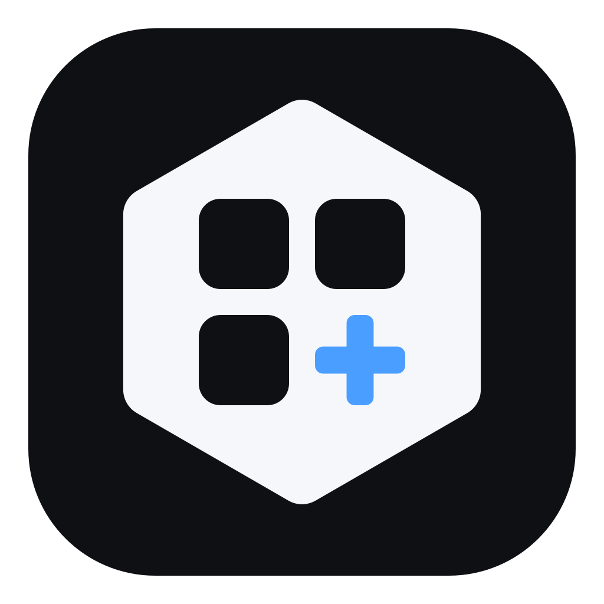
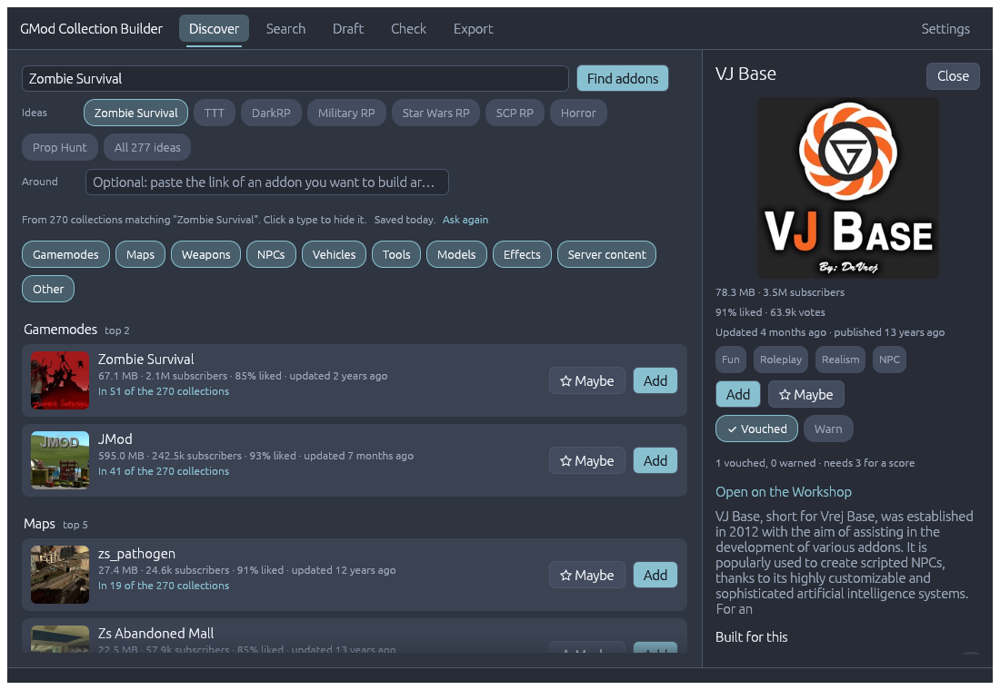
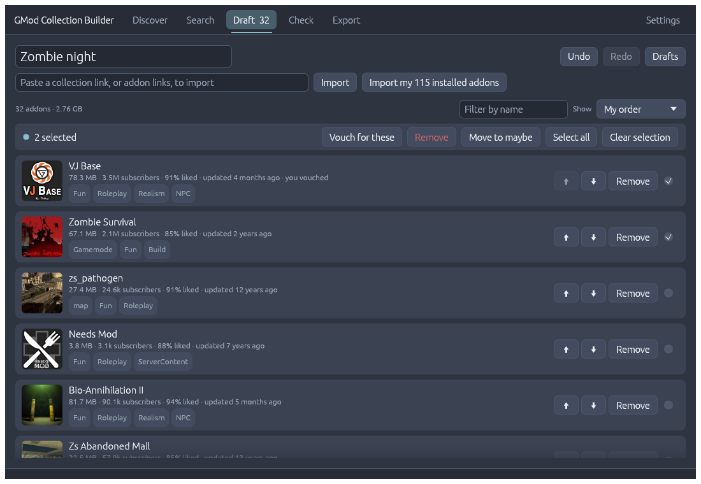
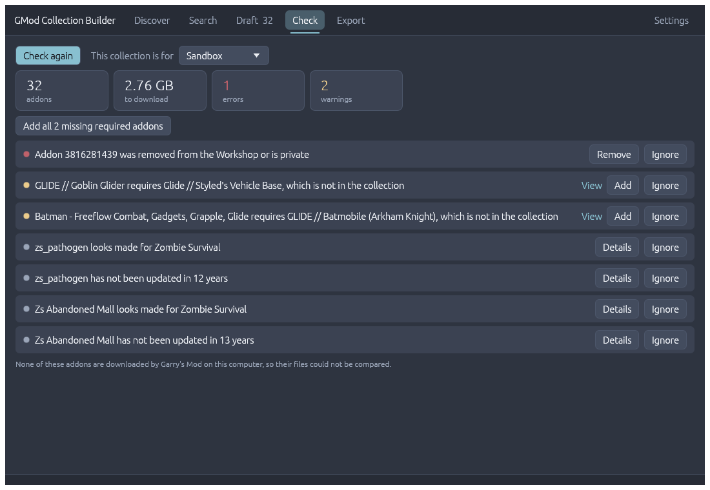

<p align="center"></p>

# GMod Collection Builder

Build Garry's Mod Workshop collections without the clicking: find addons for what you are building, put a list together, check it for problems, push it into a real Steam collection, and export the files a server needs.



It has two parts, both written in Rust:

- **Desktop app** – discover, search, build a draft, check it, export.
- **Browser extension** – adds the draft's addons to your Steam collection, and removes the ones you dropped. Steam has no API for editing collections, so this has to happen in a browser where you are logged in.

Made by fans. Not affiliated with Valve or Facepunch Studios.

## Getting it

Download from [Releases](https://github.com/novagwamrtx-hub/Gmod-builder/releases/latest):

- **Windows** – `gmod-collection-builder.exe`. It is a single file: put it anywhere and run it. Windows may say it "protected your PC", because the file is not signed. Choose *More info*, then *Run anyway*.
- **Linux** – `gmod-collection-builder-linux-x86_64.tar.gz`. Built automatically and less tried than the Windows one.
- **Extension** – `gmod-collection-builder-extension.zip`. Unzip it. In Chrome, or a browser built on it, open `chrome://extensions`, turn on *Developer mode* and choose *Load unpacked*. In Firefox 140 or newer, open `about:debugging`, *This Firefox*, *Load Temporary Add-on* and pick `manifest.json`; Firefox forgets it when it closes.

Or [build it yourself](#building).

## Using it

1. Open the app. In **Settings**, get a [Steam Web API key](https://steamcommunity.com/dev/apikey) (free; any domain name works). Copy it and the app offers to use it. Discovering, searching and required-item checks need the key; importing and inspecting collections do not.
2. **Discover**: say what you are building, or pick one of the 277 ideas that drop down from the search field (type to narrow them), or paste an addon you want to build around. The app reads the 300 best-rated collections that match, keeps the ones that really are about your theme, and shows the addons they have in common, grouped by type. Addons that are in every collection of any kind are ranked down. Answers are kept for three days, so asking again is instant.
3. **Search** the Workshop by name and tags (right-click a tag to exclude it), or switch to *Collections* and open one to pick addons out of it. Click an addon's name anywhere for details, what it requires, what is built for it, and more from its author.
4. **Draft** is your list. It saves itself, and *Drafts* switches between the ones you have. Adding an addon also adds what it requires. *Maybe* keeps candidates aside without adding them. Tick several addons to remove them, move them to the maybe pile or vouch for them in one go, and type in *Filter by name* to find one in a long list. Ctrl+Z undoes. You can import a collection, a pasted list of addon links, or everything Garry's Mod has downloaded on this computer.
5. **Check** flags removed, banned or private addons, missing required items, several gamemodes, addons made for a different gamemode than you said the collection is for, and very old addons. For addons Garry's Mod has downloaded on this computer it also reads their files and reports addons that overwrite each other. From the second check on, it lists what changed since last time: which addons were updated, removed or came back. *Ignore* silences a finding for good.
6. **Export → Send to Steam**: create a collection on Steam (or use one you have), paste its link and press the button. Your browser opens the collection's edit page and the extension's panel shows what it will add and what the collection has that your draft does not. A draft of more than about 170 addons is too long to travel in a link; it is on your clipboard instead, to paste into the panel.
7. For a server, **Export** saves `workshop.lua` (goes in `garrysmod/lua/autorun/server/`) and copies the `+host_workshop_collection` launch option. Where the addon files are on this computer, `workshop.lua` leaves out script-only addons and sends each map only while the server is on it. It also copies the addon list, grouped by type, formatted for a Steam description or for Discord.





### Vouches

Builders telling each other what works.

- **To vouch**, click the name of an addon anywhere in the app. In the panel that opens, press **Vouch** if it worked well in a collection of yours, or **Warn** if it was broken or clashed with other addons. Press it again to take it back. A collection opened from Search → Collections has the same two buttons.
- **For several at once**, tick them in Draft and press **Vouch for these**.
- **To share**, go to Settings → Vouches and press **Share**. Your browser opens a filled-in issue on this repository; press **Create**. That needs a GitHub account, which is what stops one person from voting many times. A workflow counts the issue and closes it, usually within a couple of minutes.

Until you share them, your verdicts stay on your computer and count only in your own copy of the app.

Once three builders have voted on something it gets a *vouch score* from 0 to 100: the share who vouched, pulled towards 50 while few have voted. Three out of three scores 71, nine out of ten 79, and thirty out of thirty 94.

What you share is public, with your GitHub account. [community/](community/README.md) has the rest: what is sent, how to take a verdict back, and what a score is worth.

### Making it yours

Settings has seven themes (the app's own Midnight, and One Dark, Dracula, Catppuccin Mocha, Tokyo Night, Gruvbox and Nord, which borrow the colours of the editor themes they are named after), a colour picker for every colour, and controls for size, row height, corner roundness, the width of the detail panel, animations and thumbnails. It also sets how many collections Discover reads, how many suggestions it shows per type, and how old an addon must be for Check to flag it.

### The extension on its own

- On a Garry's Mod addon's Workshop page it adds an **Add to basket** button. Open any of your collections' edit pages and the basket is waiting in the panel.
- On a collection's edit page, **Use my subscribed items** loads everything you are subscribed to, to add in one go or to copy into the app.

## What it talks to

There is no server behind this, and no telemetry. The app contacts:

- **Steam's Web API**, with your key, for everything about addons and collections.
- **Steam's image servers**, for thumbnails. They are kept on disk for a month, so each is downloaded once.
- **GitHub**, when it starts: for the vouch scores, and to see whether a newer version is out. Each can be turned off in Settings.

While the key field in Settings is empty and that tab is open, the app looks at the clipboard once a second to notice a key being copied. It does nothing with any other text.

Your key is stored unencrypted in the app's settings file; treat it like a password. On Windows the app's files are in `%APPDATA%\gmod-collection-builder` (settings, drafts, your vouches) and `%LOCALAPPDATA%\gmod-collection-builder` (thumbnails and saved discoveries, which are safe to delete).

The extension talks only to `steamcommunity.com`, using the session you are already logged in with, and collects nothing. It uses the same `addchild` and `removechild` requests as the page's own buttons; they are undocumented and Steam may change them. Removing asks for a second click.

## Building

Needs [Rust](https://rustup.rs).

```bash
cargo run --release -p gmcb-desktop
```

The extension also needs the WebAssembly target and wasm-pack:

```bash
rustup target add wasm32-unknown-unknown
cargo install wasm-pack
wasm-pack build crates/extension --target web --release --no-typescript
```

Then load `crates/extension` as an unpacked extension, the same way as the downloaded one.

[CONTRIBUTING.md](CONTRIBUTING.md) has the checks to run, two ways to see changes without clicking through everything, and how a release is made.

## Layout

| Where | What it is |
| --- | --- |
| `crates/core` | Steam Web API client, discovery ranking, collection checks, `.gma` reader, exports, vouch scoring. Shared by both programs. |
| `crates/desktop` | The app (egui). `src/app/` is what it knows and does, `src/ui/` is what it draws, with a file per tab. |
| `crates/extension` | The extension. Rust compiled to WebAssembly, plus the `manifest.json` and a small `loader.js` that browsers require. |
| `community/` | Shared vouches and the scores made from them. Written by a workflow. |
| `assets/` | The icon, and the pictures on this page. |

## Notes

- A discovery costs about 85 Steam Web API requests; Steam allows 100,000 a day per key.
- The ideas were each tried against the Workshop in October 2026 and kept only if enough of the best-rated matching collections were on the theme.
- Conflict detection and the trimmed `workshop.lua` cover the addons whose files Garry's Mod has downloaded on this computer. Old addons that Steam still keeps packed are imported like the rest, but their files are not read.
- Licensed under [Apache 2.0](LICENSE).
